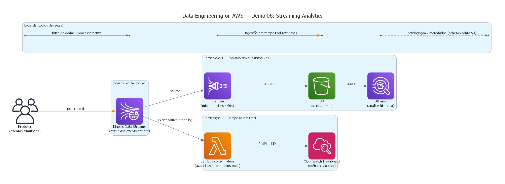

# Demo 06 — Streaming Analytics

Curso: **Data Engineering on AWS** · Domínio de exemplo: plataforma de cursos online

Demo **autônoma** e independente das demais. Mostra o paradigma de **dados em
movimento** (streaming), em contraste com o batch das outras demos. Eventos da
plataforma em tempo real chegam ao **Kinesis Data Streams** e são processados por
**duas ramificações em paralelo**:



> Diagrama gerado por [`../diagrams/architecture-demo06.py`](../diagrams/architecture-demo06.py)
> (ícones oficiais da AWS via a biblioteca `diagrams`).

```
  Produtor (simula eventos ao vivo)
        │  put_record
        ▼
  Kinesis Data Streams  (aws-class-events-stream, ON_DEMAND)
        │
        ├────────────────────────────┐
        ▼                            ▼
  Firehose → S3 (JSON)         Lambda consumidora
  (ingestão analítica)         → PutMetricData (CloudWatch)
        │                            │
        ▼                            ▼
     Athena                   CloudWatch Dashboard (quase tempo real)
  (análise histórica)         (métricas do stream ao vivo)
```

- **Ramificação 1 (ingestão analítica):** o Firehose entrega o stream ao S3 em
  micro-batches; o Athena consulta o acumulado. Padrão "streaming → data lake".
- **Ramificação 2 (tempo real):** uma Lambda consome o stream e publica métricas no
  CloudWatch; um **dashboard** as plota quase ao vivo.

---

## Estrutura

```
demo-06-streaming-analytics/
├── README.md
├── docs/
│   └── RUNBOOK.md              Guia operacional passo a passo (bash + PowerShell)
├── infra/
│   └── streaming-demo.yaml     CFN: Kinesis, S3, Firehose, Lambda consumidora, CloudWatch Dashboard, papéis
├── src/
│   ├── producer/
│   │   └── produce_events.py   Produtor: envia eventos simulados ao Kinesis
│   └── lambda/
│       └── consumer.py         Consumidor: lê o stream, publica métricas no CloudWatch
├── sql/
│   └── queries.sql             Tabela externa + consultas sobre os dados no S3
└── scripts/
    ├── bash/                   Scripts .sh (Linux/macOS/Git Bash)
    │   ├── deploy.sh           Empacota e implanta o stack
    │   └── run-producer.sh     Inicia o produtor
    └── powershell/             Scripts .ps1 (Windows)
        ├── deploy.ps1
        └── run-producer.ps1
```

> O passo a passo operacional completo está em
> **[`docs/RUNBOOK.md`](docs/RUNBOOK.md)**.

---

## Guia da demo

### 1. Implantar
```bash
./scripts/bash/deploy.sh          # Linux/macOS/Git Bash
```
```powershell
.\scripts\powershell\deploy.ps1   # Windows
```
Cria o stream Kinesis, o bucket, o Firehose, a Lambda consumidora (com seu event
source mapping a partir do Kinesis) e o dashboard do CloudWatch.

### 2. Abrir o dashboard do CloudWatch
Nos Outputs do stack está `DashboardUrl`. Abra-o (CloudWatch → Dashboards →
`aws-class-streaming`). No início estará vazio.

### 3. Iniciar o produtor (simular o stream)
```bash
./scripts/bash/run-producer.sh 10 300          # Linux/macOS/Git Bash
```
```powershell
.\scripts\powershell\run-producer.ps1 10 300   # Windows
```
Envia ~10 eventos/seg durante 5 min. Deixe esta janela rodando e **observe o
dashboard**: em ~1-2 min você começará a ver as linhas de "Eventos por tipo" e "por
curso" se movendo. Esse é o streaming ao vivo.

### 4. Consultar o acumulado no Athena (ramificação de ingestão)
Depois de alguns minutos (o Firehose entrega a cada ~60s), no Athena:
- Crie a tabela externa (query 1 de `athena/queries.sql`, ajuste o bucket).
- Rode as consultas de contagem por tipo/curso/região.

---

## Conceitos do módulo que esta demo cobre

- **Kinesis Data Streams**: ingestão de eventos em tempo real; modo ON_DEMAND (sem
  gerenciar shards).
- **Dois padrões de consumo do mesmo stream em paralelo**: entrega para
  armazenamento (Firehose→S3) e processamento em tempo real (Lambda).
- **Kinesis Data Firehose**: entrega gerenciada ao S3 em micro-batches (particionada
  por data).
- **Métricas personalizadas + CloudWatch Dashboard**: observabilidade do stream em
  quase tempo real.
- **Streaming vs batch**: o tempo real se vê no CloudWatch (segundos); a análise
  histórica, no Athena sobre o S3 (o acumulado).

### Nota sobre "tempo real"
O CloudWatch com métricas personalizadas atualiza em granularidade de ~1 minuto, e
o Firehose entrega ao S3 a cada ~60s. Não é latência de milissegundos, mas para a
demo o stream se reflete de forma quase imediata. Para latência sub-segundo
usariam-se ferramentas como o Managed Service for Apache Flink (fora do escopo
desta demo).

> Custo: Kinesis ON_DEMAND, Firehose e Lambda são baratos por uso. Apague o stack
> ao terminar os testes.
